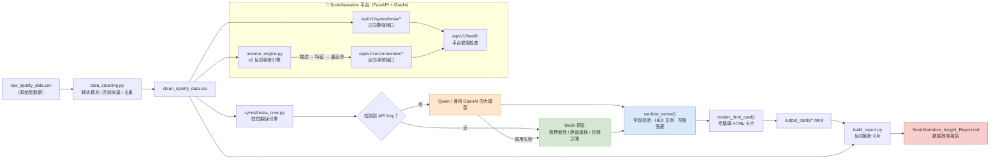

# 🎧 SonicNarrative · 特征感知翻译器

> **把一首歌的音频特征，翻译成你能看见、能走进去的场景。**
> A Synesthetic Engine that translates audio features into visual scenes, emotions, and AI art prompts.

---

## 一、项目愿景

传统音乐数据看板把歌曲拆成一串 `0.81 / 0.83 / 0.56` 的数字——准确，但冰冷，不产生任何感受。

SonicNarrative 想做相反的事：**让数据被感受到。**

输入一首歌的 Spotify 音频特征，引擎会把它翻译成一张「感知卡片」：一套有温度的配色、一段第二人称的沉浸式描述、三个 emoji，以及一段可直接投喂给 Midjourney 的英文提示词。

> 当你把 `valence` 读成色温、把 `tempo` 读成节奏、把 `acousticness` 读成材质，
> 数据看板就不再是表格，而变成一段可以走进去的旅程。

**设计信条：规则优先，LLM 润色。** 色彩基调、光影、材质由确定性规则决定（可解释、可归因、零成本），大模型只负责在这个框架内创作文字——这样即使 API 挂了，流水线依然能出卡片。

---

## 二、通感映射体系

| 音频特征 | 映射到 | 高 | 中 | 低 |
|---|---|---|---|---|
| **Valence** 情绪积极度 | 色彩冷暖 | 暖色（橙/金/暖粉） | 中性（青绿/淡紫） | 冷色（深蓝/靛/灰紫） |
| **Energy** 能量强度 | 光影对比 | 高对比、强光束、锐利 | 中等对比 | 漫射柔光、朦胧 |
| **Danceability** 舞蹈性 | 图形节奏 | 重复几何、强律动 | 中度重复 | 自由流动、不规则 |
| **Acousticness** 原声度 | 材质手感 | 有机（木/水/雾/植物） | 混合 | 数字（霓虹/金属/故障） |
| **Tempo** 速度 BPM | 时间形状 | >120：密集短促 | 90–120：中速 | <90：舒展留白 |

---

## 三、系统架构



**容错链条（三层）**：真实大模型 → 失败降级到 Mock 预设 → 再失败用终极兜底卡片。任何一层出问题，流水线都不会中断。

---

## 四、快速开始

```bash
# 1. 建虚拟环境（放在项目目录内，不占 C 盘）
python -m venv .venv
.venv\Scripts\python.exe -m pip install -r requirements.txt -i https://pypi.tuna.tsinghua.edu.cn/simple

# 2. 清洗数据
.venv\Scripts\python.exe data_cleaning.py

# 3. 批量生成卡片（不配 Key 也能跑，会自动进入 Mock 模式）
.venv\Scripts\python.exe synesthesia_core.py

# 4. 生成数据故事报告
.venv\Scripts\python.exe build_report.py

# 5. 启动平台（先后端、再前端）
.venv\Scripts\python.exe -m uvicorn main:app --host 127.0.0.1 --port 8000
.venv\Scripts\python.exe gradio_app.py        # 浏览器打开 http://127.0.0.1:7860
```

### 平台 API 一览（FastAPI 网关）

| 方法 | 路径 | 说明 |
|---|---|---|
| POST | `/api/v1/synesthesia/translate` | 音频特征 → 感知卡片 |
| GET | `/api/v1/synesthesia/gallery` | 已生成样本列表 |
| POST | `/api/v1/recommender/reverse` | 一段感受 → 最贴切的那首歌（v2 反向寻歌） |
| GET | `/api/v1/recommender/library` | 曲库概况（总量 / 有效 / 过滤脏数） |
| GET | `/api/v1/health` | 平台级健康检查（真实探测各子模块状态） |

> 交互文档自动生成：`http://127.0.0.1:8000/docs`

### 接入真实大模型

引擎走 **OpenAI 兼容协议**，换平台只需改环境变量，不用动代码：

```bash
# 硅基流动（免费模型可用，如 Qwen/Qwen3-8B）
set DASHSCOPE_API_KEY=sk-你的密钥
set DASHSCOPE_BASE_URL=https://api.siliconflow.cn/v1
set QWEN_MODEL=Qwen/Qwen3-8B

# 阿里云百炼（默认端点，免费额度需选「华北2-北京」地域）
set DASHSCOPE_API_KEY=sk-你的密钥
set DASHSCOPE_BASE_URL=https://dashscope.aliyuncs.com/compatible-mode/v1
set QWEN_MODEL=qwen-plus
```

> ⚠️ **Key 只走环境变量，不要写进任何文件。**

---

## 五、Agent 工作流

本项目由 WorkBuddy Agent 分五个阶段自动推进，每个阶段产出可验证的交付物：

| 阶段 | Agent 指令要点 | 产出 | 验证方式 |
|---|---|---|---|
| **1. 环境部署** | 在项目目录建 venv，用清华源装 pandas + openai | `.venv/`、`requirements.txt` | `pip list` 确认版本 |
| **2. 流水线执行** | 运行核心脚本处理 CSV 前 5 首，报错自主修复重试 | `output_cards/*.html` | 检查是否全部为 LLM 模式、零降级 |
| **3. 质量自检** | 反向解析卡片，检查场景名/配色是否重复 | 去重后的卡片 | 脚本统计重复项 |
| **4. 报告生成** | 提取歌曲名/场景名/AI Prompt，写故事化报告 | `SonicNarrative_Insight_Report.md` | 人工通读 + 标签唯一性校验 |
| **5. 桌面交付** | 报告 + 卡片文件夹打包复制到桌面 | `SonicNarrative_分析成果交付/` | 目录清单核对 |

**自主修复实例**（阶段 2 真实发生）：
- 发现两首特征相近的歌返回了**完全相同的配色** → 加入「规则硬约束」让模型按特征定色温基调
- 发现场景名反复出现同一个词 → 加入「批次去重提示」，把已用过的词传给下一首
- 实现时踩到 `NameError` → 容错机制自动降级到 Mock 未崩溃，定位后一次性修复

---

## 六、核心代码

### 1. 一行生成卡片

```python
from synesthesia_core import generate_sense_card, save_card

features = {"valence": .81, "energy": .83, "danceability": .56,
            "acousticness": .01, "tempo": 171}

html_str, sense_data = generate_sense_card(features, {"track_name": "Blinding Lights"})
save_card(html_str, "output_cards/my_card.html")
```

### 2. 三层容错

```python
if use_llm and API_KEY:
    raw_data = call_qwen_api(features, safe_meta, avoid_titles, avoid_palettes)
    if raw_data is not None:
        mode_note = "· LLM 生成"
    else:
        raw_data = pick_mock_preset(features)      # ① API 挂了 → Mock 预设
        mode_note = "· Mock 兜底（API 不可用）"
else:
    raw_data = pick_mock_preset(features)          # ② 没配 Key → Mock 预设

sense = sanitize_sense(raw_data)                   # ③ 字段校验 + 终极兜底
html_str = render_html_card(sense, features, safe_meta, mode_note)
```

### 3. 规则定基调，模型填细节

```python
# 小模型在特征相近时会偷懒收敛到同一套配色，
# 先用规则把色彩基调定死，再让模型在框架内创作。
if v >= 0.7:   tone = "暖色调（橙 / 金 / 暖粉为主）"
elif v >= 0.4: tone = "中性色调（青绿 / 淡紫为主）"
else:          tone = "冷色调（深蓝 / 靛蓝 / 灰紫为主）"
```

### 4. 空值兜底的正确姿势

```python
def _as_text(value):
    """None 必须转成空字符串。
    str(None) == "None" 是个真值，会直接绕过 `if desc:` 的兜底判断，
    导致卡片上印出字面量 "None"（模型返回 JSON null 时极易踩到）。"""
    if value is None:
        return ""
    return str(value).strip()
```

---

## 七、目录结构

```
SonicNarrative_Project/
├── data_cleaning.py                    # 第一步：数据清洗
├── synesthesia_core.py                 # 第二步：联觉翻译引擎 + HTML 渲染
├── reverse_engine.py                   # v2：反向寻歌引擎（描述 → 特征 → 最近邻）
├── usage_example.py                    # 第三步：单函数封装的用法示例
├── build_report.py                     # 数据故事报告生成器
├── main.py                             # FastAPI 平台 API 网关（挂载各子模块路由 / 健康检查）
├── gradio_app.py                       # Gradio 前端交互层（纯 HTTP 调后端）
├── core/                               # 平台配置 / 日志 / 子模块运行时探测
│   ├── config.py                       # 路径、CORS、MODULES 注册表、probe 函数
│   └── logging_config.py               # 统一日志格式
├── routers/                           # 各子模块路由
│   ├── synesthesia.py                  # 翻译器（/synesthesia/*）
│   └── recommender.py                  # 反向寻歌（/recommender/*）
├── schemas/                           # pydantic 请求 / 响应模型
│   ├── common.py                       # 统一响应信封 ApiResponse[T] / HealthData
│   ├── synesthesia.py                  # 翻译器契约
│   └── recommender.py                  # 反向寻歌契约
├── raw_spotify_data.csv                # 原始脏数据（含缺失/越界/重复，用于自测）
├── clean_spotify_data.csv              # 清洗后的数据（反向寻歌的曲库）
├── SonicNarrative_Insight_Report.md    # 生成的洞察报告
├── output_cards/                       # 生成的 HTML 感知卡片
└── requirements.txt
```

---

## 八、路线图

- **v1（已完成）**：正向翻译（特征 → HTML 卡片）、批量报告生成
- **v2（进行中）**：反向寻歌 ✅ **已上线**（描述感受 → 反推特征 → 加权欧氏距离最近邻检索，**无需 embedding / 向量库**）；上传音频自动提取特征（librosa，规划中）
- **v3（构想）**：自定义映射参数、3D 沉浸式场景、社区歌单分享

### v2 反向寻歌（Reverse Recommender）核心思路

正向翻译的逆运算，分两步：

```
描述（自然语言）
   │ ① 反推特征：大模型理解语义 / 没 Key 自动降级关键词规则（饱和累加，不冲极值）
   ▼
5 个音频特征（valence / energy / danceability / acousticness / tempo）
   │ ② 检索歌曲：加权欧氏距离最近邻（tempo 必须先归一化 40~220 → 0~1，否则量纲淹没）
   ▼
曲库里最贴切的那批歌（带匹配度 0~100，可解释）
```

**为什么不用深度学习？** 曲库只有几首歌时，最近邻比训练模型更靠谱、更可解释；将来换 Kaggle 那套 11 万首的数据集，引擎代码一行都不用改（曲库走 mtime 缓存，更新 CSV 自动生效）。

---

## 九、已知限制

- 免费/小参数模型（7B–8B）存在**用词与配色收敛**倾向，本项目已用「规则约束 + 批次去重」缓解，换用更大参数模型可进一步改善。
- Mock 模式是**按特征挑预设**，不是随机返回，但不具备真实模型的创造力。
- 色彩基调由规则保证，具体色值由模型生成——两者结合，既有可解释性也有随机性。
- **反向寻歌的曲库越小，最近邻的代表性越弱**。当前 demo 曲库 33 首（约 26 首为 Spotify 音频特征的近似示例值，区间覆盖全），结果仅供演示；扩大曲库后推荐质量会明显提升——只需往 `clean_spotify_data.csv` 追加真实歌曲即可，引擎代码零改动。

---

## 十、测试

项目用 `pytest` 做三层验证，全部**不需要起服务、不需要 API Key**：

```bash
# 装测试依赖（已装可跳过）
.venv\Scripts\python.exe -m pip install pytest --index-url https://pypi.org/simple

# 跑全部测试
.venv\Scripts\python.exe -m pytest -q

# 只跑某一层
.venv\Scripts\python.exe -m pytest tests/test_reverse_engine.py -q   # 纯函数
.venv\Scripts\python.exe -m pytest tests/test_synesthesia.py -q       # 引擎容错
.venv\Scripts\python.exe -m pytest tests/test_api.py -q               # API 集成
```

| 层 | 文件 | 测什么 | 关键技术 |
|---|---|---|---|
| 单元测试 | `tests/test_reverse_engine.py` | 距离/匹配度/曲库加载/关键词兜底 | 纯函数直接断言 |
| 引擎测试 | `tests/test_synesthesia.py` | 特征夹回、Mock 出卡、文件名安全 | `use_llm=False` 不联网 |
| API 集成 | `tests/test_api.py` | /health /reverse /library /translate /422 /CORS | `FastAPI TestClient` 内存调 |

**加新用例**：在对应文件里写一个 `def test_xxx():`，用 `assert` 表达预期，再跑 `pytest`。退出码 `0`=全通过、`非0`=有失败，可直接接 CI。

---

*数据科学 × 产品思维 × LLM 工程化 ｜ 简历作品项目*
